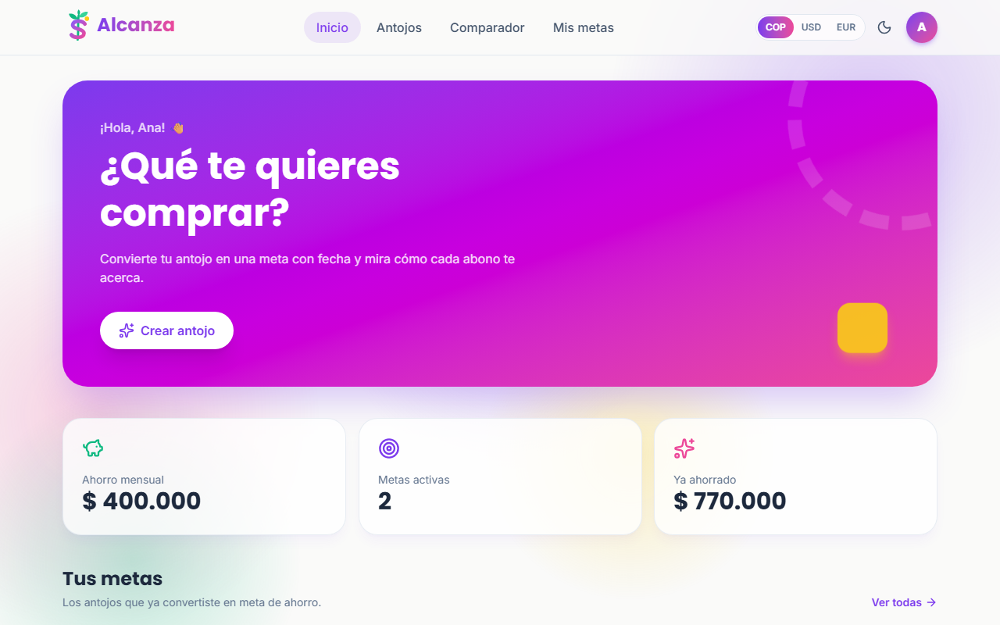
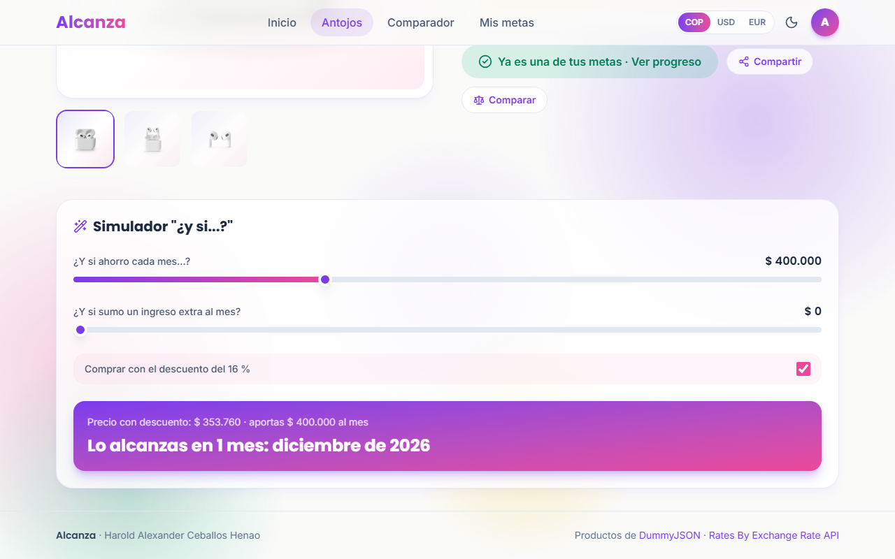
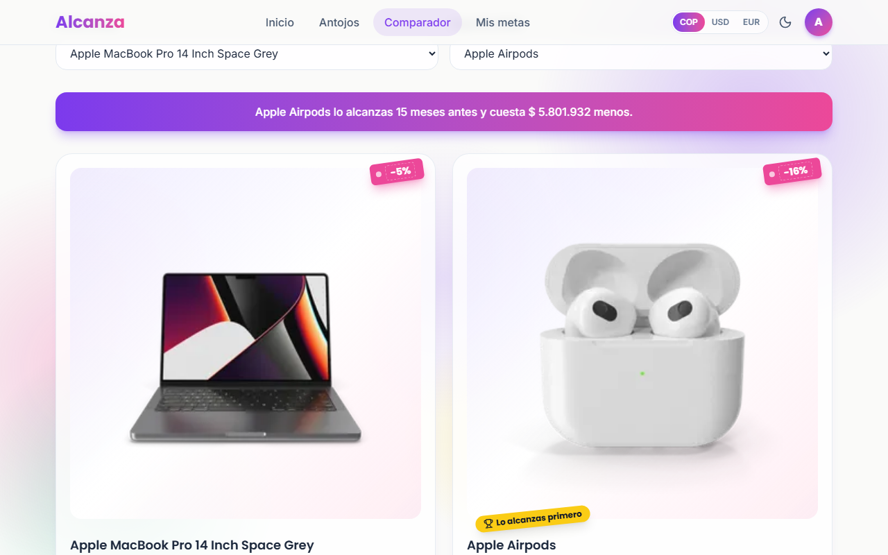
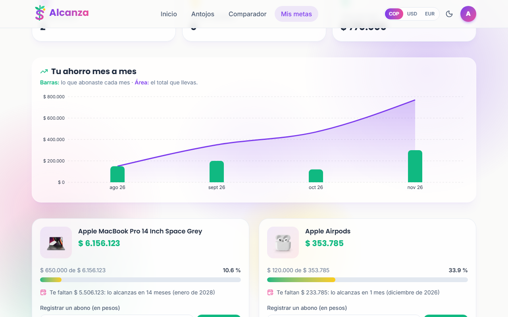
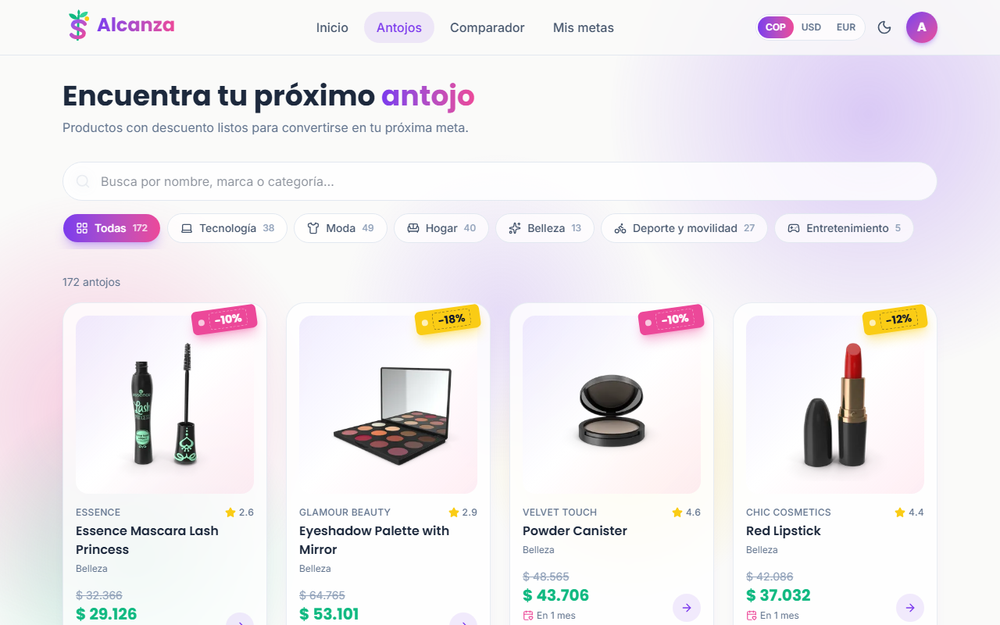

# Alcanza — ¿Cuándo me lo compro?

Aplicación web que convierte un antojo en una meta de ahorro con fecha. Eliges un producto, la app te dice en qué mes lo alcanzas con lo que ahorras y te acompaña abono por abono hasta que lo logras.

Proyecto final del módulo **Creación de páginas web 2** · Harold Alexander Ceballos Henao



## Qué se puede hacer

- **Crear una cuenta**, iniciar sesión y recuperar la contraseña por correo, con verificación anti-robots de Cloudflare Turnstile.
- **Buscar antojos** en un catálogo con filtro por categorías y buscador.
- **Ver precios en COP, USD o EUR** con tasas de cambio reales.
- **Saber cuándo alcanzas cada producto** según tu ahorro mensual.
- **Simular "¿y si...?"**: cambiar el ahorro, sumar un ingreso extra o quitar el descuento, y ver cómo se mueve la fecha.
- **Comparar dos antojos** lado a lado.
- **Convertir un antojo en meta**, registrar abonos y celebrar con confeti al llegar al 100 %.
- **Ver tu ahorro mes a mes** en un gráfico y tus metas en una línea de tiempo.
- **Descargar una tarjeta** de tu antojo como imagen para compartirla.
- **Editar tu perfil**, poner tu foto, cambiar la contraseña y usar modo oscuro.

## Capturas

| Simulador "¿y si...?" | Comparador |
|---|---|
|  |  |

| Mis metas y gráfico de ahorro | Catálogo |
|---|---|
|  |  |

## Tecnologías

| Parte | Herramientas |
|---|---|
| Interfaz | React 19, Vite 8, React Router 7 |
| Estilos y animación | Tailwind CSS 4, Framer Motion, Lucide React |
| Funciones especiales | Recharts (gráfico), html-to-image (tarjeta en PNG), canvas-confetti |
| Datos | Axios, DummyJSON (productos), ExchangeRate-API (tasas de cambio) |
| Seguridad | Cloudflare Turnstile (anti-robots), tokens de Laravel Sanctum, límite de intentos |
| Backend | Laravel 13, Sanctum, MySQL 8.4 (`data_alcanza`), Sail/Docker, Mailpit |
| Calidad y documentación | oxlint, TypeDoc, Postman + Newman |

## Instalación

Se necesita **Node.js 24** o superior y, para el backend, **Docker** dentro de **Ubuntu en WSL2**.

### 1. Backend (Laravel)

El backend está en un repositorio aparte, `alcanza-api`. Desde una terminal de Ubuntu, dentro de esa carpeta:

```bash
cp .env.example .env
docker run --rm -u "$(id -u):$(id -g)" -v "$(pwd):/var/www/html" -w /var/www/html laravelsail/php84-composer:latest composer install --ignore-platform-reqs
./vendor/bin/sail up -d
./vendor/bin/sail artisan key:generate
./vendor/bin/sail artisan migrate
./vendor/bin/sail artisan storage:link
```

La API queda en `http://localhost/api` y los correos de prueba se ven en Mailpit: `http://localhost:8025`.

> La primera vez, MySQL tarda unos segundos en quedar listo. Si `migrate` falla, espera medio minuto y vuelve a ejecutarlo.
>
> Si Ubuntu se apaga, los contenedores se detienen. Para trabajar sin cortes, deja `./vendor/bin/sail up` corriendo en una terminal.

### 2. Frontend (React)

En la carpeta de este repositorio:

```bash
npm install
```

```bash
npm run dev
```

Abre `http://localhost:5173`. La dirección de la API se toma de `VITE_API_URL`; si necesitas cambiarla, copia `.env.example` como `.env`.

La verificación anti-robots usa por defecto la clave de prueba de Cloudflare Turnstile, que siempre aprueba y muestra la franja "Solo para pruebas". Al desplegar se pone la clave real en `VITE_TURNSTILE_SITE_KEY`, y su clave secreta en el backend.

## Cómo se usa

1. **Regístrate** con nombre, correo y contraseña.
2. En la **Bienvenida**, escribe cuánto ahorras al mes.
3. Entra a **Antojos** y abre un producto: verás en qué mes lo alcanzas.
4. Prueba el **simulador**, compártelo o pulsa **Convertir en meta**.
5. En **Mis metas**, registra tus abonos y mira crecer el gráfico.

## Comandos

| Comando | Qué hace |
|---|---|
| `npm run dev` | Servidor de desarrollo |
| `npm run build` | Versión de producción en `dist/` |
| `npm run preview` | Sirve localmente la versión de producción |
| `npm run lint` | Revisa el código con oxlint |
| `npm run docs` | Genera la documentación del código en `docs/codigo/` |

## Estructura

```
src/
  components/  piezas reutilizables, agrupadas por función
  context/     estado global: sesión, perfil, metas, moneda y tema
  data/        categorías y productos propios
  hooks/       hooks personalizados (useFetch, useMetas, useFormulario…)
  layouts/     plantilla con menú y pie de página
  pages/       una página por ruta
  services/    comunicación con las APIs
  utils/       cálculos, formatos, validaciones y animaciones
  App.jsx      rutas y proveedores
  index.css    Tailwind y paleta "Fintech festival"
docs/          fuentes de los PDF, capturas y documentación generada
.claude/       agentes y skills usados para desarrollar el proyecto
```

## Decisiones de diseño

- **Capas separadas.** Las páginas no hablan con las APIs: pasan por un hook y un servicio. Por eso el perfil pudo pasar de `localStorage` a Laravel cambiando un solo archivo.
- **Cálculos como funciones puras.** Lo que determina las fechas está en `utils/calculos.js`, sin depender de React.
- **Montos guardados en pesos.** Las metas se guardan en COP y se convierten solo al mostrarlas, según la moneda elegida.
- **La URL como estado.** Los filtros del catálogo y los antojos del comparador van en la dirección, así que un enlace conserva lo elegido.
- **Backend por capas.** Ruta → Controlador → Servicio → Repositorio con interfaz → Modelo, con Form Requests para validar y políticas para que cada persona solo toque sus metas.
- **Estilo "Fintech festival".** 80 % limpio y 20 % fiesta: degradados violeta y rosa, acentos menta y amarillo, Poppins en títulos e Inter en textos. Las animaciones respetan la preferencia de movimiento reducido del sistema.

## Documentación

- [Documento de la idea](ALCANZA_idea_presentable.pdf)
- [Cómo funciona el código](ALCANZA_documentacion_codigo.pdf)
- [El backend, paso a paso](ALCANZA_documentacion_backend.pdf)
- Referencia del código: ejecuta `npm run docs` y abre `docs/codigo/index.html`.

## Créditos

- Productos de [DummyJSON](https://dummyjson.com). Son ficticios, aptos para esta versión.
- [Rates By Exchange Rate API](https://www.exchangerate-api.com).
